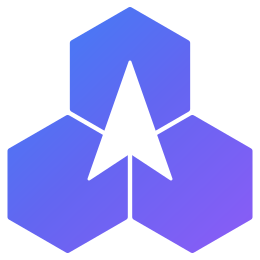

<p align="center">
  <a href="https://adhar.io">
    <picture>
      <source media="(prefers-color-scheme: dark)" srcset="apps/docs/public/branding/adhar-logo-dark.svg" />
      
    </picture>
  </a>
</p>

<h1 align="center">Adhar UI - The open, framework-agnostic design system</h1>

<p align="center">
  
  
  
  
  
  
</p>

<p align="center">
  
  
  
  
  
  
  
</p>

<p align="center">
  <sub>Own your components. Ship to any framework. Sync with your design tools.</sub>
</p>

---

## What is Adhar UI?

Adhar UI is a design system where **you own every line of code**. Components are copied into your project -- not installed as dependencies. Read, modify, and extend them freely.

| | |
|-|-|
| 🧩 **Own the code** | Components live in your repo, not in `node_modules`. No lock-in, no wrapper APIs. |
| 🌐 **Write once, ship everywhere** | One Mitosis source compiles to React, Vue, SolidJS, Svelte, and Angular. |
| 🎨 **Design-tool native** | Tokens round-trip between code, Figma, and Penpot in W3C DTCG format. |
| ♿ **Accessible by default** | Keyboard navigation, focus management, and ARIA semantics built into every primitive. |
| 🤖 **AI-ready** | Chat, streaming text, prompt input, and model selector components out of the box. |

### At a glance

- **97 components** -- from primitives (Button, Input, Card) to enterprise (Data Table, Kanban, Form Builder) and AI (Chat, Streaming Text, Prompt Input)
- **16 blocks** -- pre-composed page sections (Login, Dashboard, Pricing, Chat, Navbar, Kanban Board, etc.)
- **5 frameworks** -- React, Vue, SolidJS, Svelte, Angular via [Mitosis](https://github.com/BuilderIO/mitosis) compilation
- **Design sync** -- bidirectional Figma & Penpot integration via W3C DTCG tokens
- **Tailwind CSS v4** -- semantic CSS variables, dark mode, full alpha compositing

---

## Quick Start

### 1. Initialize

```bash
# npm (recommended)
npx @adhar-ui/cli init

# yarn
yarn dlx @adhar-ui/cli init

# pnpm
pnpm dlx @adhar-ui/cli init

# bun
bunx @adhar-ui/cli init

# deno
deno run -A jsr:@adhar-ui/cli init
```

The CLI auto-detects your framework, package manager, and meta-framework (Next.js, Nuxt, SvelteKit, Astro, etc.) and sets up:

- `adhar-ui.json` -- configuration
- `src/lib/utils.ts` -- `cn()` class merging utility
- `src/globals.css` -- theme CSS variables (light + dark)
- Dependencies: `clsx`, `tailwind-merge`, `class-variance-authority`

### 2. Add components

```bash
# Add specific components
npx @adhar-ui/cli add button card dialog input

# Add enterprise components
npx @adhar-ui/cli add data-table kanban-board file-upload tree-view

# Add AI components
npx @adhar-ui/cli add chat prompt-input streaming-text code-block

# Add pre-composed blocks
npx @adhar-ui/cli add block-login block-dashboard block-pricing

# Add everything
npx @adhar-ui/cli add --all
```

Dependencies resolve automatically -- adding `data-table` also installs `table`, `button`, `checkbox`, `dropdown-menu`, and `badge`.

### 3. Use

```tsx
import { Button } from "@/components/ui/button"
import { Card, CardContent, CardHeader, CardTitle } from "@/components/ui/card"

export default function Page() {
  return (
    <Card>
      <CardHeader>
        <CardTitle>Welcome</CardTitle>
      </CardHeader>
      <CardContent className="flex gap-3">
        <Button>Primary</Button>
        <Button variant="outline">Outline</Button>
        <Button variant="destructive" size="sm">Delete</Button>
      </CardContent>
    </Card>
  )
}
```

### 4. Customize

Components are your source code. Edit variants directly:

```tsx
// src/components/ui/button.tsx
const buttonVariants = cva("...", {
  variants: {
    variant: {
      default: "bg-primary text-primary-foreground",
      brand: "bg-indigo-600 text-white hover:bg-indigo-700",  // your custom variant
    },
    size: {
      default: "h-10 px-4",
      xl: "h-14 rounded-lg px-12 text-lg",  // your custom size
    },
  },
})
```

---

## Components (89)

### Basic (44)

Core primitives with full accessibility, keyboard navigation, and screen reader support:

| Category | Components |
|----------|-----------|
| **Form Controls** | Button, Input, Textarea, Label, Checkbox, Radio Group, Switch, Select, Slider, Toggle, Toggle Group, Combobox, Multi Select, Input OTP, Tag Input, Search Input, Number Input |
| **Display** | Badge, Avatar, Avatar Group, Separator, Skeleton, Progress, Spinner, Aspect Ratio, Kbd, Copy Button, Image |
| **Layout** | Card, Tabs, Accordion, Collapsible, Scroll Area, Table, Resizable, Split View |
| **Feedback** | Alert, Alert Dialog, Toast |
| **Overlay** | Dialog, Sheet, Tooltip, Popover, Hover Card, Drawer, Bottom Sheet |
| **Navigation** | Dropdown Menu, Context Menu, Menubar, Navigation Menu, Breadcrumb, Pagination, Sidebar |

### Advanced (12)

Composed patterns for complex interactions:

Command Palette, Calendar, Date Picker, Color Picker, Carousel, Chart, Form (with validation), Form Builder, File Upload, Rich Text Editor, Empty State, Stat Card

### Enterprise (33)

Production-grade components for business and AI applications:

| Category | Components |
|----------|-----------|
| **Data** | Data Table, Kanban Board, Timeline, Tree View, Stepper, Transfer List, Token Counter, Sortable List, Drag and Drop, Notification |
| **Charts** | Chart, Area Chart, Bar Chart, Line Chart, Pie Chart, Radar Chart, Scatter Chart, Gauge Chart, Candlestick Chart, Heatmap, Sparkline, Treemap, Funnel Chart |
| **Navigation** | Responsive Sidebar |
| **AI & Chat** | Chat, Prompt Input, Streaming Text, Code Block, Model Selector, Thinking Indicator, Feedback Buttons, Suggestion Chips, Message Bubble |

---

## Blocks (16)

Pre-composed page sections combining multiple components:

| Block | Description |
|-------|------------|
| **Login Form** | Email/password form with social login |
| **Dashboard Stats** | Metric cards with trends |
| **Notification Feed** | Avatar list with timestamps |
| **Settings Panel** | Grouped toggles with descriptions |
| **Pricing Table** | Feature comparison with CTA |
| **Command Palette** | Cmd+K search with keyboard nav |
| **Hero Section** | Headline, description, CTA buttons |
| **User Profile Card** | Avatar, stats, follow/message |
| **Navigation Bar** | Logo, links, search, user menu |
| **Data Table** | Sortable table with status badges |
| **Chat Interface** | Messages, typing indicator, input |
| **File Upload** | Drag-drop zone with progress |
| **Team Members** | List with roles and status |
| **App Sidebar** | Grouped nav with badges |
| **Kanban Board** | Task columns with priorities |
| **Footer Section** | Multi-column with links |

---

## Theming

### Switch presets

```bash
npx @adhar-ui/cli theme zinc      # Neutral gray (default)
npx @adhar-ui/cli theme slate     # Cool blue-gray
npx @adhar-ui/cli theme blue      # Vibrant blue
npx @adhar-ui/cli theme green     # Nature green
npx @adhar-ui/cli theme violet    # Purple/violet
npx @adhar-ui/cli theme rose      # Pink/rose
npx @adhar-ui/cli theme orange    # Warm orange
npx @adhar-ui/cli theme teal      # Teal/cyan
```

### Custom themes

```bash
npx @adhar-ui/cli theme create my-brand
```

All colors are HSL CSS custom properties (29 semantic tokens). Supports alpha compositing (`bg-primary/50`) and class-based dark mode.

```css
:root {
  --primary: 240 5.9% 10%;
  --primary-foreground: 0 0% 98%;
  --radius: 0.5rem;
}
.dark {
  --primary: 0 0% 98%;
  --primary-foreground: 240 5.9% 10%;
}
```

---

## Design Resources

Downloadable design kits for Figma and Penpot:

| File | Format | Description |
|------|--------|------------|
| Figma Component Kit | SVG | All 89 components with variants |
| Penpot Component Kit | SVG | Import-ready component library |
| Color Palette | SVG | Light + dark mode swatches |
| Design Tokens | JSON | W3C DTCG format (colors, spacing, typography, shadows) |

### Sync tokens between code and design tools

```bash
# Push tokens to Figma/Penpot
npx @adhar-ui/cli design-sync push --target=figma

# Pull tokens from design tool back to code
npx @adhar-ui/cli design-sync pull --source=figma

# Export as W3C DTCG JSON
npx @adhar-ui/cli design-export dtcg
```

---

## CLI Reference

```bash
npx @adhar-ui/cli <command>
```

| Command | Description |
|---------|------------|
| `init` | Initialize project (detects framework, creates config) |
| `add <components...>` | Add components (resolves dependencies) |
| `add --all` | Add all components |
| `list` | List available components |
| `list --json` | JSON output |
| `diff` | Compare local vs registry |
| `theme <preset>` | Switch theme preset |
| `theme create <name>` | Scaffold custom theme |
| `doctor` | Check project health |
| `design-sync push` | Push tokens to design tool |
| `design-sync pull` | Pull tokens from design tool |
| `design-export dtcg` | Export W3C DTCG tokens |

---

## Architecture

```
Mitosis Source (.lite.tsx)
  ├── React     (JSX + hooks)
  ├── Vue 3     (.vue SFC)
  ├── SolidJS   (JSX + createSignal)
  ├── Svelte    (.svelte, Svelte 4 syntax)
  └── Angular   (standalone components)
```

Each component follows this structure:

```
packages/primitives/src/components/<name>/
  <Name>.lite.tsx       # Mitosis source
  <name>.styles.ts      # CVA variants (Tailwind classes)
  <name>.types.ts       # TypeScript interfaces
  <name>.a11y.ts        # Accessibility spec
```

See [packages/primitives/README.md](packages/primitives/README.md) for the Mitosis authoring rules.

---

## Project Structure

```
adhar-ui/
  deno.json                       # Workspace root (19 packages + 2 apps)
  packages/
    tokens/                       # Design tokens (4 presets, CSS generator)
    tailwind-preset/              # Tailwind CSS v4 preset
    utils/                        # cn() utility, responsive helpers
    a11y/                         # Accessibility primitives
    icons/                        # SVG icon registry
    primitives/                   # CVA style definitions (40+ exports)
    react/ vue/ solid/            # Compiled framework outputs
    svelte/ angular/
    cli/                          # CLI tool
    registry/                     # Component registry (97 components + 36 blocks)
    dtcg/                         # W3C DTCG token converter
    design-sync/                  # Sync engine + conflict resolution
    figma-plugin/                 # Figma plugin
    penpot-plugin/                # Penpot plugin
    sync-server/                  # Webhook handler
    code-connect/                 # Figma Code Connect
  apps/
    docs/                         # Documentation portal
    storybook/                    # 97 component stories
  scripts/netlify-build.sh        # Builds docs + Storybook into ./dist
  .github/workflows/              # CI and Netlify deploys
```

---

## Development

```bash
git clone https://github.com/adhar-io/adhar-ui.git && cd adhar-ui

# Development
deno task check                # Type-check all packages
deno task lint                 # Lint
deno task fmt                  # Format
deno task test                 # Run tests
deno task docs:dev             # Start docs site (localhost:5173)
deno task storybook:dev        # Start Storybook (localhost:6006)
deno task cli --help           # Run CLI locally

# Build
deno task build                # Build all packages
deno task build:primitives     # Compile Mitosis to 5 frameworks
bash scripts/netlify-build.sh  # Build the docs + Storybook site into ./dist
```

---

## Deployment

The docs site (`/`) and Storybook (`/storybook/`) deploy to Netlify as one static site, from GitHub Actions:

| Workflow | Trigger | What it does |
| --- | --- | --- |
| `.github/workflows/ci.yml` | push to `main`, pull requests | type-check, lint, test, build all packages |
| `.github/workflows/deploy.yml` | push to `main`, manual run | build the site and deploy it to production |
| `.github/workflows/deploy.yml` | pull requests from this repo | deploy a preview and comment its URL on the PR |

One-time setup:

1. Create a Netlify site (Add new site → Deploy manually is enough; no Git link needed).
2. In the GitHub repo, add two Actions secrets: `NETLIFY_AUTH_TOKEN` (Netlify → User settings → Applications → Personal access tokens) and `NETLIFY_SITE_ID` (Site configuration → Site details → Site ID).
3. If the Netlify site is also linked to the repo, turn off its own builds (Site configuration → Build & deploy → Stop builds) so pushes don't build twice.

Redirects, security headers and cache rules live in `netlify.toml` and are applied to CLI deploys as well.

---

## Configuration

### `adhar-ui.json`

```json
{
  "framework": "react",
  "typescript": true,
  "tailwind": {
    "css": "src/globals.css",
    "baseColor": "zinc",
    "cssVariables": true
  },
  "aliases": {
    "components": "@/components",
    "ui": "@/components/ui",
    "utils": "@/lib/utils"
  },
  "design": {
    "figma": { "fileKey": "...", "variableCollectionName": "Adhar UI" },
    "penpot": { "instanceUrl": "https://design.penpot.app", "fileId": "..." },
    "syncMode": "manual",
    "conflictStrategy": "prompt"
  }
}
```

---

## Tech Stack

| | |
|-|-|
| **Runtime** | [Deno](https://deno.land) 2.6+ / Node 20+ / Bun 1.x |
| **Compiler** | [Mitosis](https://github.com/BuilderIO/mitosis) |
| **Styling** | [Tailwind CSS](https://tailwindcss.com) v4 |
| **Variants** | [CVA](https://cva.style) (Class Variance Authority) |
| **Class Merging** | [clsx](https://github.com/lukeed/clsx) + [tailwind-merge](https://github.com/dcastil/tailwind-merge) |
| **Tokens** | [W3C DTCG](https://www.designtokens.org/) |
| **Design Tools** | [Figma](https://figma.com) + [Penpot](https://penpot.app) |
| **Dev Server** | [Vite](https://vitejs.dev) |

---

## Contributing

Contributions are welcome. Read [CONTRIBUTING.md](CONTRIBUTING.md) before opening a pull request, and run `deno task check`, `deno task lint`, and `deno task test` locally first.

---

## License

Released under the [Apache License 2.0](https://www.apache.org/licenses/LICENSE-2.0).

---

<p align="center">
  <a href="https://adhar.io">
    
  </a>
</p>

<p align="center">
  <strong>Adhar UI</strong> &mdash; Part of the <a href="https://adhar.io">Adhar Platform</a>
</p>
